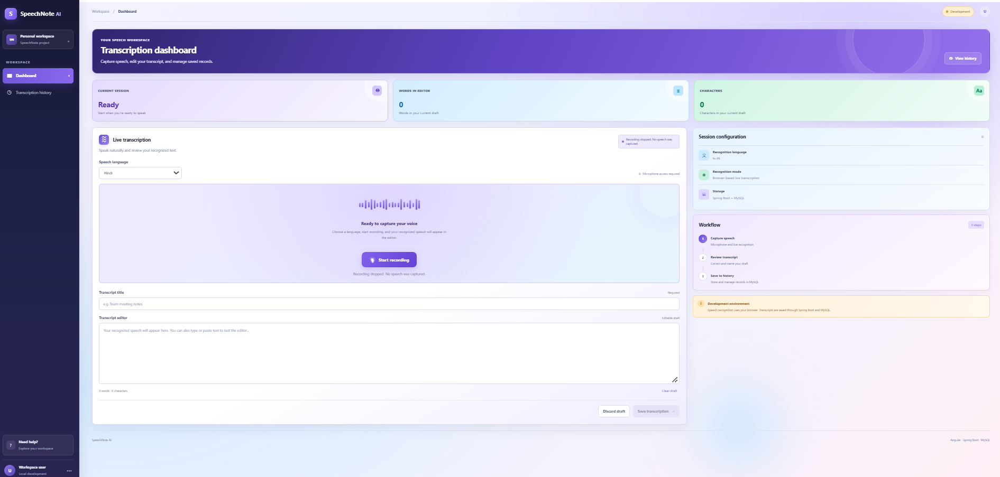
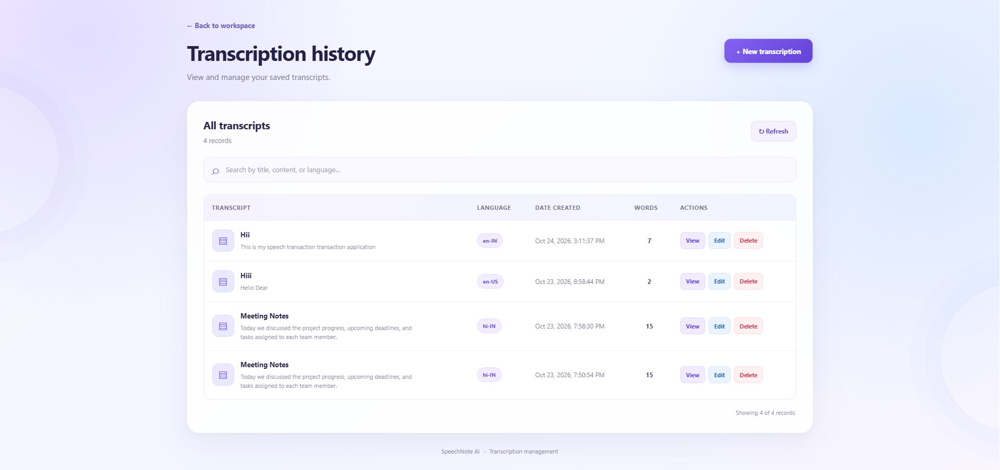

# 🎙️ SpeechNote AI — Real-Time Speech-to-Text Application

SpeechNote AI is a full-stack web application that converts spoken words into text using browser-based speech recognition. Users can edit transcripts, save them to a MySQL database, and manage their transcription history through a web interface.

The application uses **Angular** for the frontend, **Java Spring Boot** for the backend REST API, and **MySQL** for persistent storage.

## 📌 Project Overview

SpeechNote AI provides a simple interface for speech recognition and transcription management.

The frontend captures speech through the browser's Speech Recognition API and displays the recognized text. Users can edit the transcript and save it through the Spring Boot REST API. The backend processes requests and stores transcription records in MySQL.

### Key Features

- **Live Speech Recognition:** Convert speech into text using supported browser speech-recognition capabilities.
- **Language Selection:** Choose from the languages configured in the application, including English, Hindi, and Kannada.
- **Transcript Editing:** Review and modify recognized text before saving.
- **Transcription History:** View and search previously saved transcripts.
- **CRUD Operations:** Create, read, update, and delete transcription records.
- **Database Persistence:** Store transcription text, title, language, and timestamps in MySQL.
- **REST API:** Connect the Angular frontend with the Spring Boot backend.
- **Responsive Interface:** Use the web application from a supported desktop or mobile browser.

> **Current limitation:** Speech recognition depends on browser support and recognition services. Mixed-language speech recognition may not be accurate in every situation. This version uses browser-based recognition rather than a self-hosted open-source speech-recognition model.

## 🛠️ Technology Stack

| Layer | Technology |
|---|---|
| Frontend | Angular, TypeScript, HTML, SCSS |
| Backend | Java, Spring Boot |
| Build Tool | Maven |
| Database | MySQL |
| Speech Recognition | Browser Speech Recognition API |
| API Communication | HTTP/REST |
| Version Control | Git and GitHub |

## 🏗️ Application Architecture

```text
User
  |
  v
Angular Frontend
http://localhost:4200
  |
  | HTTP REST API
  v
Spring Boot Backend
http://localhost:8081
  |
  | JDBC / JPA
  v
MySQL Database
localhost:3306
Database: speechnote_db
```

### Request Flow

1. The user opens the Angular application.
2. The browser performs speech recognition and returns recognized text.
3. The user reviews or edits the transcript.
4. When saved, the frontend sends the transcription to the backend API.
5. Spring Boot validates and processes the request.
6. The backend stores or retrieves records from MySQL.
7. The frontend displays the result and transcription history.

## 📁 Project Structure

```text
SpeechNote-AI/
├── speechnote-frontend/
│   ├── public/
│   ├── src/
│   │   ├── app/
│   │   │   ├── dashboard/
│   │   │   ├── services/
│   │   │   └── transcription-history/
│   │   ├── index.html
│   │   ├── main.ts
│   │   └── styles.scss
│   ├── angular.json
│   ├── package.json
│   └── tsconfig.json
│
├── speechnote-backend/
│   ├── src/
│   │   ├── main/
│   │   │   ├── java/com/speechnote_backend/
│   │   │   │   ├── SpeechnoteBackendApplication.java
│   │   │   │   ├── Transcription.java
│   │   │   │   ├── TranscriptionController.java
│   │   │   │   ├── TranscriptionService.java
│   │   │   │   ├── TranscriptionRepository.java
│   │   │   │   ├── TranscriptionNotFoundException.java
│   │   │   │   └── GlobalExceptionHandler.java
│   │   │   └── resources/
│   │   │       └── application.properties
│   │   └── test/
│   ├── pom.xml
│   ├── mvnw
│   └── mvnw.cmd
│
└── README.md
```

## ⚙️ Prerequisites

Install the following software before running the application:

- Java JDK compatible with the project's `pom.xml`
- Node.js and npm
- Angular CLI (optional if using `npx ng`)
- MySQL Server
- Git

Check your installations:

```bash
java -version
node --version
npm --version
git --version
```

To check Maven, run `mvn -version`, or use the Maven wrapper included in the backend.

## 🚀 Installation and Setup

### Step 1: Clone the Repository

```bash
git clone https://github.com/anp143/SpeechNote-AI.git
cd SpeechNote-AI
```

### Step 2: Create the MySQL Database

Start MySQL and execute:

```sql
CREATE DATABASE speechnote_db;
```

The backend uses Spring Data JPA and the configured Hibernate schema-update setting to create or update the required table structure.

### Step 3: Configure Backend Environment Variables

Open a terminal and configure the database settings.

The backend reads the following environment variables:

| Variable | Example for local development |
|---|---|
| `PORT` | `8081` |
| `DB_URL` | `jdbc:mysql://localhost:3306/speechnote_db?useUnicode=true&characterEncoding=UTF-8&serverTimezone=UTC` |
| `DB_USERNAME` | `root` |
| `DB_PASSWORD` | Your local MySQL password |

The password must be configured in your environment; do not commit database credentials to GitHub.

**Windows Command Prompt example:**

```cmd
set DB_URL=jdbc:mysql://localhost:3306/speechnote_db?useUnicode=true&characterEncoding=UTF-8&serverTimezone=UTC
set DB_USERNAME=root
set DB_PASSWORD=YOUR_LOCAL_MYSQL_PASSWORD
set PORT=8081
```

Replace `YOUR_LOCAL_MYSQL_PASSWORD` with your own MySQL password. These variables apply to the current Command Prompt session.

### Step 4: Start the Spring Boot Backend

Open Command Prompt in the backend folder:

```cmd
cd speechnote-backend
mvnw.cmd spring-boot:run
```

Alternatively, if Maven is installed:

```bash
mvn spring-boot:run
```

The backend is configured to use port **8081 by default**.

Backend base URL:

`http://localhost:8081`

Keep this terminal open while using the application.

### Step 5: Start the Angular Frontend

Open a **second terminal** in the repository root:

```cmd
cd speechnote-frontend
npm install
npx ng serve
```

Open the frontend in your browser:

**http://localhost:4200**

Keep the frontend terminal open while using the application.

## 🌐 Local URLs and Ports

| Component | Local URL | Default port |
|---|---|---:|
| Angular frontend | `http://localhost:4200` | 4200 |
| Spring Boot backend | `http://localhost:8081` | 8081 |
| MySQL server | `localhost:3306` | 3306 |

These are local development addresses. They are not public deployment URLs.

## 🔌 Backend API

The backend exposes REST endpoints for managing transcriptions. The exact request mappings should be checked in `TranscriptionController.java`.

The API operations are expected to cover the following functionality:

| Operation | Purpose |
|---|---|
| Create | Save a new transcription |
| Read | Retrieve one or more saved transcriptions |
| Update | Edit a saved transcription |
| Delete | Remove a saved transcription |

**Note:** Confirm the exact endpoint paths, HTTP methods, and JSON request fields in the controller source before using them in Postman or documenting individual URLs.

## 🗄️ Database Information

- **Database:** `speechnote_db`
- **Database engine:** MySQL
- **ORM:** Spring Data JPA / Hibernate
- **Schema management:** Hibernate `update` configuration

The transcription entity includes fields for the record ID, title, transcript text, language, creation time, and update time.

For production deployments, use a managed database and secure credentials. Review database schema-management settings before production use.

## 🗣️ Speech Recognition Notes

Speech recognition is performed by the browser, not by the Spring Boot server.

- A supported browser and microphone permission are required.
- Language availability and recognition accuracy depend on the browser and its speech-recognition service.
- Automatic mixed-language recognition is not guaranteed.
- Microphone access is generally expected to work on `localhost` during development and on HTTPS for deployed applications.

## 🧰 Troubleshooting

### Frontend does not start

Verify Node.js and npm are installed. From the frontend directory, run:

```bash
npm install
npx ng serve
```

### Backend does not start

Verify Java is installed and check the Maven wrapper output:

```cmd
mvnw.cmd spring-boot:run
```

Check that the selected port is not already occupied.

### MySQL connection fails

Confirm that:

- MySQL is running.
- `speechnote_db` exists.
- `DB_URL`, `DB_USERNAME`, and `DB_PASSWORD` are correct.
- The database user has permission to access the database.

### Transcripts do not save or load

Confirm the backend is running at `http://localhost:8081`. Check the browser developer console and the Spring Boot terminal for HTTP errors and backend exceptions. Verify the frontend API base URL matches the backend address.

### Speech recognition does not work

Allow microphone access, use a browser that supports the Speech Recognition API, and verify the selected language. Recognition may require internet access depending on the browser implementation.

## ☁️ Deployment

To deploy SpeechNote AI:

1. Deploy the Angular frontend to a static hosting provider.
2. Deploy the Spring Boot backend to a Java-compatible hosting provider.
3. Create a managed MySQL database.
4. Configure `DB_URL`, `DB_USERNAME`, `DB_PASSWORD`, and the hosting port in the backend environment.
5. Update the frontend API base URL to use the deployed backend's HTTPS address.
6. Configure CORS to allow the deployed frontend origin.

**Live deployment URLs:** Add the actual frontend and backend URLs here after deployment. No public deployment URL is configured in this documentation yet.

## 🔐 Security Considerations

- Never commit database passwords, API keys, or other secrets.
- Use HTTPS for deployed environments.
- Restrict CORS to trusted frontend origins.
- Use appropriate database credentials and permissions.
- Review authentication and authorization requirements before exposing the application publicly.

## 📌 Project Status

SpeechNote AI includes browser-based speech recognition, transcript editing, and persistent transcription-history management through a Spring Boot backend and MySQL database.

Further improvements may include stronger mixed-language recognition, improved deployment configuration, and additional production security controls.

## 👨‍💻 Author

**Annappa N**

GitHub: [anp143](https://github.com/anp143)

## 📄 License

No license has been specified yet. Add a `LICENSE` file if you intend to publish this project under an open-source license.


## 📸 Application Screenshots

### Dashboard


### Transcription History
